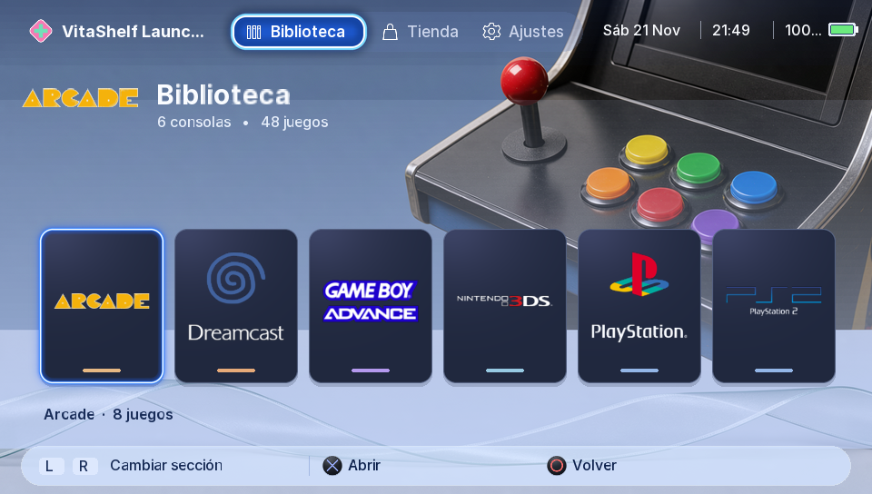

# VitaShelf Launcher

Homebrew launcher for PS Vita/PSTV. Browse your local library and connect your personal [RomM](https://romm.app/) server from a single interface.

> Use only with games and software you are entitled to use. VitaShelf Launcher does not include games, emulators, or a RomM server.

## Capturas / Screenshots

Capturas reales de la app ejecutándose en Vita3K. La primera muestra una biblioteca sincronizada desde RomM; la segunda indica dónde configurar tu servidor RomM. / Real screenshots of the app running in Vita3K. The first shows a library synchronized from RomM; the second points to the RomM server setup.

### Biblioteca / Library

### Vistas de ROMs / ROM views

La Biblioteca ofrece tres maneras de explorar cada plataforma: grilla, lista con detalle y carrusel. / The Library offers three ways to browse each platform: grid, detailed list, and carousel.

#### Grilla / Grid

#### Lista / List

#### Carrusel / Carousel

### Integraciones → RomM / Integrations → RomM

## Español

### 1. Instalar

**Necesitás:** una PS Vita o PSTV con homebrew y [VitaShell](https://github.com/TheOfficialFloW/VitaShell) instalado.

1. Descargá `vitashelflauncher.vpk` desde la [última release](https://github.com/niconunez96/VitaShelfLauncher/releases/latest).
2. Copialo a la consola con VitaShell: conectala por USB o FTP y transferí el archivo a cualquier carpeta de `ux0:`.
3. En VitaShell, seleccioná el archivo `.vpk` y presioná `X`. Confirmá la instalación.
4. Volvé a LiveArea y abrí **VitaShelf Launcher**.

### 2. Configurar RomM

1. En la app, abrí **Ajustes → Integraciones → RomM**.
2. Elegí **URL del servidor**, presioná `X` e ingresá la URL base de tu RomM; por ejemplo, `http://192.168.1.100:8080`.
3. En RomM, creá un código con **Pair Device** para un cliente con los permisos mínimos de lectura y descarga.
4. En VitaShelf, elegí **Pair code**, ingresá el código y presioná `Triángulo` para canjearlo y sincronizar el catálogo.

El código se usa una sola vez. No compartas el archivo de configuración de la app: contiene el token de acceso recibido. Para descargas pausadas, presioná `X` para reanudar o `Cuadrado` para quitarlas de la cola.

Los ajustes se ordenan en **Integraciones**, **Descargas**, **Apariencia** y **Acerca de**. En **Apariencia**, elige uno de los cuatro fondos con la cruceta y `X`, o toca su miniatura. **Fondo animado** muestra un interruptor para activar o desactivar el vaivén continuo del fondo; cámbialo con `X` o tocando la fila. Todos los ajustes de apariencia se guardan automáticamente. La vista de ROM elegida con `Triángulo` (cuadrícula, lista o carrusel) también se guarda y se restaura al reiniciar. En **Acerca de** puedes consultar la versión, el espacio libre, las rutas de almacenamiento y la carpeta PSP ISO; si RomM está conectado, también verás el servidor, la cantidad de juegos de su catálogo y la última sincronización. Si aún no hay un catálogo sincronizado para ese servidor, se indica sin mostrar datos de otro servidor.

El servicio de imágenes público se configura automáticamente en una instalación nueva: no hace falta ingresar credenciales ni configurar nada. Si indicas un host propio o local en **Integraciones → Image Service**, ese endpoint vuelve a funcionar sin autenticación, como antes.

### 3. Juegos PSP desde RomM

Con Adrenaline instalado, las descargas PSP de RomM en `.iso` o `.cso` se guardan en `ux0:/pspemu/ISO/`. Los ZIP que contienen una sola imagen se extraen allí y luego se eliminan. Presiona `X` para iniciar el juego: si falta o está desactivado el complemento incluido, una segunda confirmación lo instala y lo habilita en Adrenaline. No hace falta instalar otra VPK ni crear un bubble adicional. `ms0:` es un alias de estilo PSP, no una carpeta visible en VitaShell: revisa `ux0:/pspemu/seplugins/`. Adrenaline 8.x también usa el formato EPI en `plugins.txt`. El complemento incluido es una variante de Pocket Shelf renombrada como `vitashelf.prx`; VitaShelf escribe la solicitud de arranque en `ux0:/pspemu/VitaShelfLauncher/boot.txt` y el registro en esa misma carpeta (en Adrenaline, `ms0:/VitaShelfLauncher/`). Si la instalación del complemento falla, consulta `ux0:data/vitashelflauncher/psp-plugin.log`; el aviso en pantalla incluye el código de error de Vita.

### 4. Juegos NDS desde RomM

Las descargas NDS de RomM se guardan en `ux0:/data/dsvita/` con la extensión del archivo original. Si el ZIP contiene una sola ROM `.nds`, se extrae allí y luego se elimina. Para iniciar el juego hace falta [DSVita](https://github.com/Grarak/DSVita) instalado, con los componentes que indica su documentación (`libshacccg.suprx` y `kubridge.skprx` 0.3.1 o superior). VitaShelf abre las ROM con `DSVITA000` y muestra un aviso si el emulador no está instalado. No hace falta agregar `launch_nds` a `config.ini`: el valor predeterminado ya está incluido. La carpeta `ux0:/data/dsvita/` debe existir antes de descargar: si falta, la app muestra un aviso y no inicia la descarga.

### 5. Juegos 3DS desde RomM

Las descargas 3DS de RomM se guardan en `ux0:/data/vitashelflauncher/downloads/romm/3ds/` con la extensión del archivo original. VitaShelf abre las ROM de un solo archivo con [Azahar Vita](https://github.com/SaNch0sE/azahar-vita-mh4u) mediante `AZAHARPSV`; si el emulador no está instalado, muestra un aviso. No hace falta agregar `launch_3ds` a `config.ini`: el valor predeterminado ya está incluido.

### 6. Juegos Dreamcast desde RomM

Las descargas Dreamcast de RomM se guardan en `ux0:/data/vitashelflauncher/downloads/romm/dreamcast/` con la extensión del archivo original. Para iniciarlos hace falta Flycast Vita instalado, junto con `libshacccg.suprx`, `kubridge.skprx` y `fd_fix.skprx` o `repatch_ex.skprx`. VitaShelf abre juegos de un solo archivo `.chd`, `.cdi`, `.gdi` o `.cue` mediante `FLYCASTDC`; no incluye el emulador. Los juegos con varios archivos (por ejemplo, un `.gdi` con pistas `.bin`) no se descargan desde la app: descárgalos desde RomM y colócalos en la carpeta de contenido de Flycast. No hace falta agregar `launch_dreamcast` a `config.ini`: el valor predeterminado ya está incluido.

### 7. Favoritos y filtros de biblioteca

Presiona `SELECT` en la página principal de Biblioteca o dentro de una consola para abrir **Filtros**. Puedes mostrar juegos ocultos o limitar la biblioteca a juegos descargados; los filtros se comparten entre todas las consolas y se conservan al reiniciar. Dentro de una consola, `Cuadrado` abre las opciones para añadir o quitar favoritos y ocultar o mostrar el juego seleccionado. **Favoritos** aparece como la primera tarjeta de Biblioteca. Los juegos ocultos se muestran atenuados con un ojo tachado cuando el filtro permite verlos.

## English

### 1. Install

**You need:** a homebrew-enabled PS Vita or PSTV with [VitaShell](https://github.com/TheOfficialFloW/VitaShell) installed.

1. Download `vitashelflauncher.vpk` from the [latest release](https://github.com/niconunez96/VitaShelfLauncher/releases/latest).
2. Copy it to the console with VitaShell: connect over USB or FTP and transfer the file to any folder in `ux0:`.
3. In VitaShell, select the `.vpk` file and press `X`. Confirm the installation.
4. Return to LiveArea and open **VitaShelf Launcher**.

### 2. Configure RomM

1. In the app, open **Settings → Integrations → RomM**.
2. Select **Server URL**, press `X`, and enter your RomM base URL; for example, `http://192.168.1.100:8080`.
3. In RomM, create a code with **Pair Device** for a client with the minimum read and download permissions.
4. In VitaShelf, select **Pair code**, enter the code, then press `Triangle` to redeem it and sync your catalog.

The code is one-time use. Do not share the app configuration file: it contains the access token received. For paused downloads, press `X` to resume or `Square` to remove them from the queue.

Settings are ordered as **Integrations**, **Downloads**, **Appearance**, and **About**. In **Appearance**, choose one of four wallpapers with the directional pad and `X`, or tap its thumbnail. **Text color** lets you pick white, light, dark, or black for better readability on light or dark wallpapers. **Animated wallpaper** has an on/off switch for the wallpaper's continuous drift; press `X` or tap the row to change it. All appearance preferences save automatically. The ROM view picked with `Triangle` (grid, list, or carousel) is saved and restored on the next launch too. **About** shows the version, free space, storage paths, and PSP ISO folder; when RomM is connected, it also shows the server, its catalog game count, and the last synchronization. A server without a synchronized catalog is identified explicitly rather than showing another server's data.

### 3. Installed Vita games and covers

Installed native Vita titles are discovered on startup and resume, and appear under **PS Vita** with the same grid, list, and carousel cards as RomM. Press `X` to launch a title directly. Local discovery and cached artwork work without RomM or an internet connection. The shared library holds up to 256 entries; local titles take priority and omitted titles are reported.

For cover artwork, open **Settings → Integrations**:

1. **Image Service**: enter the host of your [image service](services/imageproxy/README.md), such as `http://192.168.1.100:8090`, and select **Test connection** (`Probar conexión`). This service is shared by RomM and SteamGridDB; an existing `image_proxy_url` is still supported.
2. **SteamGridDB**: enter your [API key](https://www.steamgriddb.com/profile/preferences/api), select **Test connection**, then **Sync covers** (`Sincronizar carátulas`). These settings save automatically. The key is masked in the settings page; keep your real configuration file private.

Artwork is resized through the shared image service and cached on the Vita. A fresh install uses the bundled public HTTPS endpoint automatically: no credential or user setup is required. Setting a custom or local host under **Image Service** keeps that endpoint unauthenticated and preserves the previous behavior. Only unambiguous name matches are selected; missing or ambiguous artwork keeps the installed application's icon. For locally installed titles, successful matches are remembered by title ID.

If **Test connection** fails, open `ux0:data/vitashelflauncher/network.log` in VitaShell after the test. New `event=image-service` records include `health-start`, the `service-http` transport result, `health-ok` or `health-failed`, and any `challenge`/`session` authentication requests. Each transport record includes the curl error number and description, HTTP status (`0` if no response was received), and response-truncation flag. A successful health request can still be followed by `auth-failed`; `auth-ok` confirms the session was accepted. These diagnostic records omit URLs, headers, request/response bodies, keys, installation IDs, and tokens. Other existing records in the same file may contain server URLs or response bodies: review and redact them before sharing. Logging is best-effort and requires writable storage; this change does not appear in older installed VPKs.

Failed service transfers also record `curl_version`, `ssl_version`, a recognized `tls_detail` label, and an `openssl_error` code with its locally decoded `reason`. The raw curl error buffer is never written because it can contain private hostnames or credentials. Unrecognized or missing details appear as `unavailable`; an all-zero OpenSSL code does not mean the transfer succeeded. Health/authentication summary lines carry only a stage label, not a misleading `curl=0` success indicator.

For an inconclusive TLS error, `errorbuffer_nonempty` distinguishes an empty curl error buffer from unrecognized text; `errorbuffer_result=0` confirms curl accepted the diagnostic buffer. `openssl_error_present=1` means a code was actually extracted, even if its value is zero. `rng_ready` records OpenSSL's `RAND_status()` immediately before the request (`1` means ready, `0` means not ready); the fixed `Insufficient randomness` label identifies curl's RNG-readiness failure. These fields are diagnostics, not permission to disable TLS verification or use predictable randomness.

The service requests also install a filtering curl debug callback before enabling verbose diagnostics. Only recognized OpenSSL `SSL_connect` error classes are retained as `tls_trace` records. Headers, bodies, and TLS-data events are discarded, except for the opt-in initial ClientHello capture described below. Availability of these error-class messages depends on the curl backend. Failed requests additionally record `os_errno` (the socket error saved by curl), `os_errno_result` (whether that query succeeded), and `trace_result` (whether trace setup succeeded). A zero socket error does not prove a successful handshake. This trace is not enabled for RomM requests.

For temporary deeper debugging, close the app, set `tls_debug=1` in `ux0:data/vitashelflauncher/config.ini`, then relaunch and run **Test connection** once. Original curl **text** messages are appended to `ux0:data/vitashelflauncher/tls-debug.log` (up to 4096 bytes per message). HTTP headers and bodies remain excluded. **The raw text is not redacted and can contain private hostnames, URLs, addresses, paths, or other sensitive details.** Keep this file private; inspect and redact it before sharing. Close the app, set `tls_debug=0`, and relaunch to stop raw capture; remove diagnostic capture files when no longer needed. Raw capture is off by default, disabling it does not erase an existing capture, and the logs can grow while enabled. The normal filtered `network.log` records remain unchanged.

The same `tls_debug=1` setting also captures the first complete outgoing **ClientHello** per request as hexadecimal text in `ux0:data/vitashelflauncher/tls-clienthello.log`, headed by `[tls-clienthello bytes=...]`. Capture requires a structurally valid handshake message of at most 16 KiB; fragments, TLS record headers, other handshake messages, and application data are not retained. This exposes the actual cipher suites and extensions offered by the Vita without router packet capture. It does not record TLS private keys or application credentials, but it can include private SNI hostnames, random/session identifiers, and resumption-ticket data: treat it as private diagnostic material. Disable `tls_debug` and restart to stop both captures. Backend message-callback availability determines whether a ClientHello is captured.

The Vita executable includes a strict IPv4 `inet_pton` compatibility wrapper: DNS names return `0`, valid dotted IPv4 addresses return `1`, and other address families retain the SDK implementation. This contains a curl 8.17/Vita SDK interaction where a negative native parser result can be mistaken for an IP address, suppressing the TLS SNI hostname. It does not disable certificate verification or force a TLS version. Device captures showed the missing SNI, and the maintainer reported restored connectivity after rebuilding with the wrapper. The native parser's hostname return value was not directly measured. For further diagnosis, a DNS-host connection should include ClientHello extension `0000` with the requested hostname.

To compare the Vita's handshake with TLS 1.2 only, set `tls12=1` in the same config and restart. Service health and authentication requests then set **both** the minimum and maximum TLS version to 1.2; `network.log` records `tls_policy=tls1.2-only setup_result=0` when the setting is accepted. If setting the bounds fails, the request is not sent with the default policy. Certificate and hostname verification remain enabled. Set `tls12=0` and restart to restore normal negotiation. This is an opt-in diagnostic experiment, not a confirmed fix or an automatic fallback; RomM requests are unaffected. Both diagnostic settings default to `0`, only the value `1` enables them, and settings saves preserve them. The previous `.enabled` marker files are no longer used.

### 4. PSP games from RomM

With Adrenaline installed, RomM PSP downloads in `.iso` or `.cso` are stored in `ux0:/pspemu/ISO/`. A ZIP containing exactly one image is extracted there and then removed. Press `X` to start a game; if the bundled plugin is missing or disabled, a second confirmation installs and enables it in Adrenaline. No extra VPK or bubble is required. `ms0:` is a PSP-style alias, not a folder visible in VitaShell; check `ux0:/pspemu/seplugins/` instead. Adrenaline 8.x also uses the EPI format in `plugins.txt`. The bundled plugin is a renamed Pocket Shelf fork called `vitashelf.prx`; VitaShelf writes the boot request to `ux0:/pspemu/VitaShelfLauncher/boot.txt` and its log in that same folder (inside Adrenaline, `ms0:/VitaShelfLauncher/`). If plugin installation fails, check `ux0:data/vitashelflauncher/psp-plugin.log`; the on-screen notice includes the Vita error code.

### 5. NDS games from RomM

RomM NDS downloads are stored in `ux0:/data/dsvita/` with the source file extension. A ZIP containing exactly one `.nds` ROM is extracted there and then removed. Launching requires [DSVita](https://github.com/Grarak/DSVita) installed, with the components listed in its documentation (`libshacccg.suprx` and `kubridge.skprx` 0.3.1 or newer). VitaShelf opens ROMs through `DSVITA000` and shows a notice if the emulator is not installed. No `launch_nds` entry is needed in `config.ini`; the default is built in. The `ux0:/data/dsvita/` folder must already exist: if it is missing, the app shows a notice and does not start the download.

### 6. 3DS games from RomM

RomM 3DS downloads are stored in `ux0:/data/vitashelflauncher/downloads/romm/3ds/` with the source file extension. VitaShelf opens single-file ROMs through [Azahar Vita](https://github.com/SaNch0sE/azahar-vita-mh4u) using `AZAHARPSV`; if the emulator is not installed, it shows a notice. No `launch_3ds` entry is needed in `config.ini`; the default is built in.

### 7. Dreamcast games from RomM

RomM Dreamcast downloads are stored in `ux0:/data/vitashelflauncher/downloads/romm/dreamcast/` with the source file extension. Launching requires Flycast Vita installed, along with `libshacccg.suprx`, `kubridge.skprx`, and `fd_fix.skprx` or `repatch_ex.skprx`. VitaShelf opens single-file `.chd`, `.cdi`, `.gdi`, or `.cue` games through `FLYCASTDC`; the emulator is not bundled. Multi-file sets (for example, a `.gdi` with `.bin` tracks) are not downloaded by the app: get them from RomM and place them in Flycast's content folder. No `launch_dreamcast` entry is needed in `config.ini`; the default is built in.

### 8. Favourites and library filters

Press `SELECT` on the main Library page or inside a console to open **Filters**. Show hidden games or limit the library to downloaded games; filters are shared across consoles and saved across restarts. Inside a console, `Square` opens options to add or remove a favourite and hide or show the selected game. **Favourites** is the first Library card. When hidden games are shown, their cards are dimmed with a crossed-eye icon.

## Development

Human contributors: see [DEVELOPMENT.md](DEVELOPMENT.md). AI agents: begin with [agents.md](agents.md).

## License and acknowledgements / Licencia y agradecimientos

VitaShelf Launcher is licensed under the GNU General Public License v3.0 — see [LICENSE](LICENSE).
VitaShelf Launcher se distribuye bajo la GNU General Public License v3.0 — véase [LICENSE](LICENSE).

Third-party asset notices are included under `assets/blueglass/` and `assets/bin/psp/`.
